# iOS: a `View` nested in `Text` sits below the text baseline

A `View` inside a `Text` (an inline view) should sit with its bottom on the
text baseline, like the letters do. Android does that. On iOS with the New
Architecture, since React Native 0.82.0 and still on `main`, it sits below the
baseline, by an amount that depends on the text around it:

```text
error = |descender of the line's font| + baseline offset - 2.76
```

- **2.76** is the descender of 12pt Helvetica, the font TextKit fills in for
  the view's own run, which React Native never gives a font.
- **The baseline offset** is `(lineHeight - font.lineHeight) / 2` when a
  `lineHeight` taller than the font's line height is set (React Native raises
  the glyphs by that much to center them in the line), and 0 otherwise.

That formula predicts the error of every sample in this repro to within
0.003pt, at the default text size and at the first accessibility size, and the
screenshots match it to the pixel. Placing the view on the baseline TextKit
laid the line out with fixes every sample.

| iOS, 0.88.0 | iOS, 0.88.0 with the fix | iOS, 0.81.6 | Android, 0.88.0 |
| --- | --- | --- | --- |
| 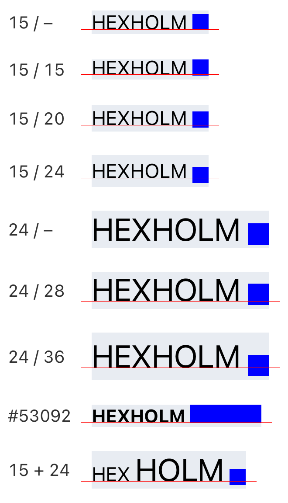 | 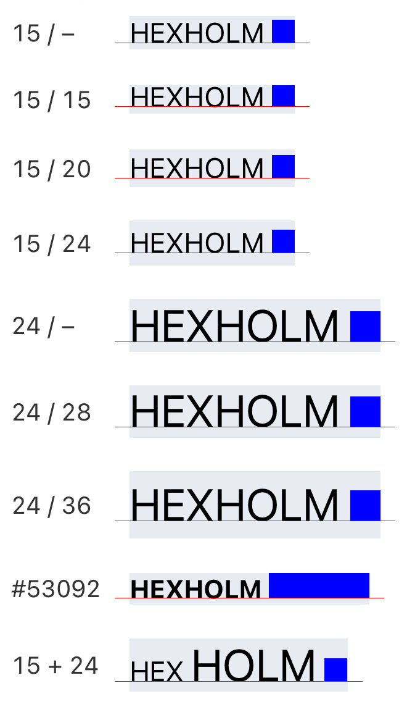 | 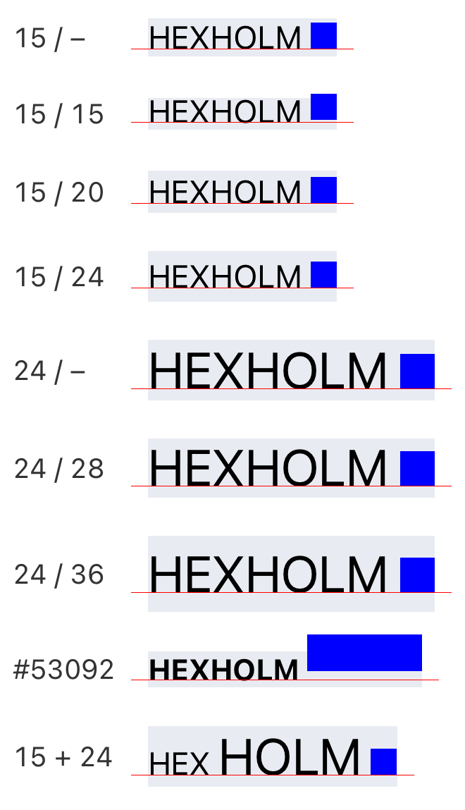 | 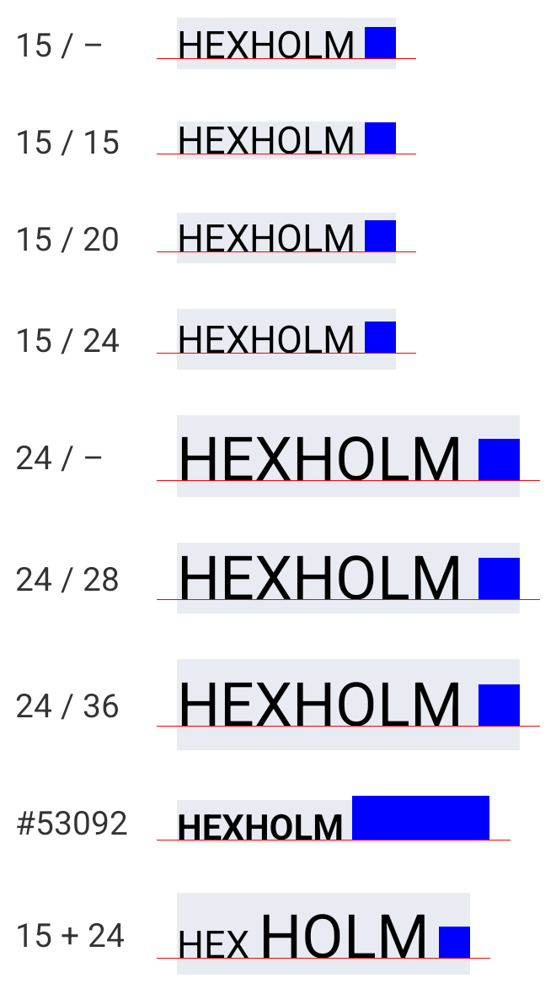 |

The red hairline is the baseline of the line, from `onTextLayout`. The letters
sit on it in every screenshot; only the blue view moves.

In the Bluesky app this is the verification badge after a display name: it sits
visibly low at the default text size, and a lot lower at the accessibility
sizes.

## Summary

The view's bottom minus the baseline, in points, measured from the screenshots
(3 pixels per point). Positive is below the baseline. 0 means exactly on it, to
the pixel.

| Sample | iOS 0.88.0 | iOS 0.88.0, AX | iOS 0.88.0 with the fix | iOS 0.81.6 | iOS 0.81.6, AX | Android 0.88.0, font scale 1 and 2 |
| --- | ---: | ---: | ---: | ---: | ---: | ---: |
| 15 / – | **+0.67** | **+3.67** | 0 | 0 | 0 | 0 |
| 15 / 15 | **+1.00** | **+3.67** | 0 | **-1.00** | 0 | 0 |
| 15 / 20 | **+2.00** | **+5.67** | 0 | 0 | 0 | 0 |
| 15 / 24 | **+4.00** | **+9.00** | 0 | 0 | 0 | 0 |
| 24 / – | **+3.00** | **+7.67** | 0 | 0 | 0 | 0 |
| 24 / 28 | **+3.00** | **+7.67** | 0 | 0 | 0 | 0 |
| 24 / 36 | **+6.67** | **+14.33** | 0 | 0 | 0 | 0 |
| #53092 | **+0.67** | **+3.33** | 0 | **-4.00** | 0 | 0 |
| 15 + 24 | **+3.00** | **+7.67** | 0 | 0 | 0 | 0 |
| Wrapped 15 / 24 | **+4.00** | **+9.00** | 0 | 0 | 0 | 0 |

"AX" is the first accessibility text size (Accessibility Medium, font scale
1.79). "With the fix" is the same at both sizes.

## What the screen shows

Each row is a `Text` with the word `HEXHOLM` and a blue `View` nested after it:
a 12pt square in 15pt text, a 16pt square in 24pt text.

- **`fontSize / lineHeight`:** no `lineHeight`, a `lineHeight` shorter than the
  font's own line height (15 / 15, 24 / 28), and taller ones.
- **#53092:** the case from
  [react/react-native#53092](https://github.com/react/react-native/issues/53092):
  bold 14pt text with `lineHeight: 14 * 1.2` and a 54×20 view, taller than the
  line.
- **15 + 24:** 15pt text with a nested 24pt `Text` before the view, so the
  line's descent comes from a different font than the view's own text.
- **Wrapped:** a 15 / 24 paragraph with the view mid-paragraph (on line 2 at
  the default size, line 4 at AX).

On each row:

- **Red hairline:** the baseline of each line, at `line.y + line.ascender` from
  `onTextLayout`.
- **Grey box:** the `Text`'s frame.
- **Number on the right:** the view's bottom minus the baseline of its line,
  from `measureLayout` (`onLayout` doesn't fire for views nested in `Text`). The
  view's frame is rounded to the pixel grid and the baseline isn't, so it's
  within about ±0.17pt of the exact value. The tables here use the device log
  and the screenshots' pixels instead.

Only the samples follow the system text size, so that the rest of the screen
stays legible at the accessibility sizes.

## Formula vs measurement

The [patch](ReproducerApp/patches/react-native+0.88.0.patch) logs, for every
inline view, the font metrics of the text before it, the `lineHeight` and
baseline offset React Native set, TextKit's line fragment and baseline, the
font on the view's own run, and both placements. From those:

- **Predicted** uses only font metrics: `|line descender| + baseline offset -
  2.76`, where the baseline offset is `(lineHeight - font line height) / 2` if
  `lineHeight` is at least the font's line height, and 0 otherwise (that's
  [`RCTApplyBaselineOffset`](#cause)).
- **Logged** is React Native's frame bottom minus TextKit's baseline, from the
  log.
- **Predicted on screen** is the logged frame and baseline rounded to the
  pixel grid the way Fabric (the view's origin) and Yoga (the hairline) do.
- **Stock / Patched on screen** are measured from the screenshots: the bottom
  edge of the blue view minus the top of the red hairline.
- **Letters** is the bottom edge of the letters minus the top of the hairline,
  in pixels, in both screenshots.

### Default text size

| Sample | Font | Line descender | `lineHeight` | Font line height | Baseline offset | **Predicted** | Logged | Predicted on screen | Stock on screen | Patched on screen | Letters |
| --- | --- | ---: | ---: | ---: | ---: | ---: | ---: | ---: | ---: | ---: | ---: |
| 15 / – | SF 15 | -3.618 | none | 17.900 | 0.000 | **+0.858** | +0.858 | +0.67 | +0.67 | 0 | 0 |
| 15 / 15 | SF 15 | -3.618 | 15.00 | 17.900 | 0.000 | **+0.858** | +0.858 | +1.00 | +1.00 | 0 | 0 |
| 15 / 20 | SF 15 | -3.618 | 20.00 | 17.900 | 1.050 | **+1.908** | +1.908 | +2.00 | +2.00 | 0 | 0 |
| 15 / 24 | SF 15 | -3.618 | 24.00 | 17.900 | 3.050 | **+3.908** | +3.908 | +4.00 | +4.00 | 0 | 0 |
| 24 / – | SF 24 | -5.789 | none | 28.641 | 0.000 | **+3.029** | +3.029 | +3.00 | +3.00 | 0 | 0 |
| 24 / 28 | SF 24 | -5.789 | 28.00 | 28.641 | 0.000 | **+3.029** | +3.029 | +3.00 | +3.00 | 0 | 0 |
| 24 / 36 | SF 24 | -5.789 | 36.00 | 28.641 | 3.680 | **+6.709** | +6.709 | +6.67 | +6.67 | 0 | 0 |
| #53092 | SF 14 bold | -3.377 | 16.80 | 16.707 | 0.046 | **+0.663** | +0.664 | +0.67 | +0.67 | 0 | 0 |
| 15 + 24 | SF 15 | -5.789 | none | 17.900 | 0.000 | **+3.029** | +3.029 | +3.00 | +3.00 | 0 | 0 |
| Wrapped 15 / 24 | SF 15 | -3.618 | 24.00 | 17.900 | 3.050 | **+3.908** | +3.908 | +4.00 | +4.00 | 0 | 0 |

### Accessibility Medium (font scale 1.79)

| Sample | Font | Line descender | `lineHeight` | Font line height | Baseline offset | **Predicted** | Logged | Predicted on screen | Stock on screen | Patched on screen | Letters |
| --- | --- | ---: | ---: | ---: | ---: | ---: | ---: | ---: | ---: | ---: | ---: |
| 15 / – | SF 26.79 | -6.462 | none | 31.970 | 0.000 | **+3.702** | +3.702 | +3.67 | +3.67 | 0 | 0 |
| 15 / 15 | SF 26.79 | -6.462 | 26.79 | 31.970 | 0.000 | **+3.702** | +3.702 | +3.67 | +3.67 | 0 | 0 |
| 15 / 20 | SF 26.79 | -6.462 | 35.72 | 31.970 | 1.875 | **+5.577** | +5.577 | +5.67 | +5.67 | 0 | 0 |
| 15 / 24 | SF 26.79 | -6.462 | 42.86 | 31.970 | 5.445 | **+9.147** | +9.149 | +9.00 | +9.00 | 0 | 0 |
| 24 / – | SF 42.86 | -10.339 | none | 51.152 | 0.000 | **+7.579** | +7.580 | +7.67 | +7.67 | 0 | 0 |
| 24 / 28 | SF 42.86 | -10.339 | 50.01 | 51.152 | 0.000 | **+7.579** | +7.580 | +7.67 | +7.67 | 0 | 0 |
| 24 / 36 | SF 42.86 | -10.339 | 64.30 | 51.152 | 6.574 | **+14.153** | +14.151 | +14.33 | +14.33 | 0 | 0 |
| #53092 | SF 25 bold | -6.031 | 30.00 | 29.839 | 0.081 | **+3.352** | +3.354 | +3.33 | +3.33 | 0 | 0 |
| 15 + 24 | SF 26.79 | -10.339 | none | 31.970 | 0.000 | **+7.579** | +7.580 | +7.67 | +7.67 | 0 | 0 |
| Wrapped 15 / 24 | SF 26.79 | -6.462 | 42.86 | 31.970 | 5.445 | **+9.147** | +9.149 | +9.00 | +9.00 | 0 | 0 |

The predicted and logged columns differ by at most 0.003pt, which is the
rounding of the logged metrics. Every "predicted on screen" value matches the
screenshot to the pixel. Some details the tables show:

- A `lineHeight` shorter than the font's (15 / 15, 24 / 28) has the same error
  as no `lineHeight`: TextKit trims the line from the top and keeps the
  descent, and React Native adds no baseline offset.
- In the 15 + 24 row the view's own text is 15pt, but the error is the 24pt
  font's: the baseline sits above the line's bottom by the largest descender on
  the line.
- The views are 12.33, 16.33 and 20.33pt rather than 12, 16 and 20:
  `ParagraphShadowNode` adds 0.01 to each inline view's size and rounds it up
  to the pixel grid. That's unrelated, and doesn't affect the bottom.

The hairline comes from `onTextLayout`, whose `ascender` is
`[layoutManager locationForGlyphAtIndex:].y`
([RCTTextLayoutManager.mm#L402](https://github.com/react/react-native/blob/f754dbd20a8548cddfa548815a6e1f4bb25b6443/packages/react-native/ReactCommon/react/renderer/textlayoutmanager/platform/ios/react/renderer/textlayoutmanager/RCTTextLayoutManager.mm#L402)),
the same TextKit value the fix uses. So the hairline isn't independent of the
fix, but the letters are: their flat bottoms end exactly at the hairline in
every row of every screenshot (the "Letters" column, and the same on 0.81.6
and Android).

### Raw log

The full output of `log stream` for both runs is in
[`measurements/logs/`](measurements/logs). These are the unique lines at the
default text size, in stock mode:

```text
[inline-baseline] attachment run attributes from React Native: EventEmitter, NSAttachment
[inline-baseline] stock: view 12.33x12.33 | text font .SFUI-Regular 15.00 (ascender 14.282, descender -3.618, lineHeight 17.900, leading 0.000), paragraph lineHeight 0.00, baseline offset 0.000 | line 0.000..17.900, glyph rect 0.000..17.900, glyph location y 14.282, baseline 14.282 | attachment font Helvetica 12.0 (descender -2.760) | stock bottom 15.141 (+0.858 from baseline), fixed bottom 14.282
[inline-baseline] stock: view 12.33x12.33 | text font .SFUI-Regular 15.00 (ascender 14.282, descender -3.618, lineHeight 17.900, leading 0.000), paragraph lineHeight 15.00, baseline offset 0.000 | line 0.000..15.000, glyph rect -0.951..15.000, glyph location y 11.382, baseline 11.382 | attachment font Helvetica 12.0 (descender -2.760) | stock bottom 12.240 (+0.858 from baseline), fixed bottom 11.382
[inline-baseline] stock: view 12.33x12.33 | text font .SFUI-Regular 15.00 (ascender 14.282, descender -3.618, lineHeight 17.900, leading 0.000), paragraph lineHeight 20.00, baseline offset 1.050 | line 0.000..20.000, glyph rect 0.000..20.000, glyph location y 15.332, baseline 15.332 | attachment font Helvetica 12.0 (descender -2.760) | stock bottom 17.240 (+1.908 from baseline), fixed bottom 15.332
[inline-baseline] stock: view 12.33x12.33 | text font .SFUI-Regular 15.00 (ascender 14.282, descender -3.618, lineHeight 17.900, leading 0.000), paragraph lineHeight 24.00, baseline offset 3.050 | line 0.000..24.000, glyph rect 0.000..24.000, glyph location y 17.332, baseline 17.332 | attachment font Helvetica 12.0 (descender -2.760) | stock bottom 21.240 (+3.908 from baseline), fixed bottom 17.332
[inline-baseline] stock: view 16.33x16.33 | text font .SFUI-Regular 24.00 (ascender 22.852, descender -5.789, lineHeight 28.641, leading 0.000), paragraph lineHeight 0.00, baseline offset 0.000 | line 0.000..28.641, glyph rect 0.000..28.641, glyph location y 22.852, baseline 22.852 | attachment font Helvetica 12.0 (descender -2.760) | stock bottom 25.881 (+3.029 from baseline), fixed bottom 22.852
[inline-baseline] stock: view 16.33x16.33 | text font .SFUI-Regular 24.00 (ascender 22.852, descender -5.789, lineHeight 28.641, leading 0.000), paragraph lineHeight 28.00, baseline offset 0.000 | line 0.000..28.000, glyph rect 0.000..28.000, glyph location y 22.211, baseline 22.211 | attachment font Helvetica 12.0 (descender -2.760) | stock bottom 25.240 (+3.029 from baseline), fixed bottom 22.211
[inline-baseline] stock: view 16.33x16.33 | text font .SFUI-Regular 24.00 (ascender 22.852, descender -5.789, lineHeight 28.641, leading 0.000), paragraph lineHeight 36.00, baseline offset 3.680 | line 0.000..36.000, glyph rect 0.000..36.000, glyph location y 26.531, baseline 26.531 | attachment font Helvetica 12.0 (descender -2.760) | stock bottom 33.240 (+6.709 from baseline), fixed bottom 26.531
[inline-baseline] stock: view 54.33x20.33 | text font .SFUI-Bold 14.00 (ascender 13.330, descender -3.377, lineHeight 16.707, leading 0.000), paragraph lineHeight 16.80, baseline offset 0.046 | line 0.000..16.800, glyph rect -6.957..16.800, glyph location y 13.377, baseline 13.377 | attachment font Helvetica 12.0 (descender -2.760) | stock bottom 14.040 (+0.664 from baseline), fixed bottom 13.377
[inline-baseline] stock: view 12.33x12.33 | text font .SFUI-Regular 15.00 (ascender 14.282, descender -3.618, lineHeight 17.900, leading 0.000), paragraph lineHeight 0.00, baseline offset 0.000 | line 0.000..28.641, glyph rect 0.000..28.641, glyph location y 22.852, baseline 22.852 | attachment font Helvetica 12.0 (descender -2.760) | stock bottom 25.881 (+3.029 from baseline), fixed bottom 22.852
[inline-baseline] stock: view 12.33x12.33 | text font .SFUI-Regular 15.00 (ascender 14.282, descender -3.618, lineHeight 17.900, leading 0.000), paragraph lineHeight 24.00, baseline offset 3.050 | line 24.000..48.000, glyph rect 24.000..48.000, glyph location y 17.332, baseline 41.332 | attachment font Helvetica 12.0 (descender -2.760) | stock bottom 45.240 (+3.908 from baseline), fixed bottom 41.332
[inline-baseline] stock: view 54.33x17.33 | text font .SFUI-Bold 14.00 (ascender 13.330, descender -3.377, lineHeight 16.707, leading 0.000), paragraph lineHeight 16.80, baseline offset 0.046 | line 0.000..16.800, glyph rect -3.957..16.800, glyph location y 13.377, baseline 13.377 | attachment font Helvetica 12.0 (descender -2.760) | stock bottom 14.040 (+0.664 from baseline), fixed bottom 13.377
```

The first line is logged before TextKit sees the string: React Native gives
the view's run only the attachment and its event emitter, no font. Every
placement line then reads `Helvetica 12.0 (descender -2.760)` as the run's
font, whatever the text's font is. The #53092 view is measured twice, at
17.33pt and 20.33pt tall; its bottom is the same both times.

## Cause

Links are to `main` at
[f754dbd](https://github.com/react/react-native/tree/f754dbd20a8548cddfa548815a6e1f4bb25b6443).
The placement is the same in every release from 0.82.0 to 0.88.1.

In `_measureTextStorage:`
([RCTTextLayoutManager.mm#L643-L653](https://github.com/react/react-native/blob/f754dbd20a8548cddfa548815a6e1f4bb25b6443/packages/react-native/ReactCommon/react/renderer/textlayoutmanager/platform/ios/react/renderer/textlayoutmanager/RCTTextLayoutManager.mm#L643-L653)),
each inline view's frame is the bottom of its glyph rect plus the descender of
the font on the view's own run:

```objc
CGRect glyphRect = [layoutManager boundingRectForGlyphRange:range inTextContainer:textContainer];

CGRect frame;
UIFont *font = [[textStorage attributedSubstringFromRange:range] attribute:NSFontAttributeName
                                                                   atIndex:0
                                                            effectiveRange:nil];
frame = {
    .origin =
        {glyphRect.origin.x,
         glyphRect.origin.y + glyphRect.size.height - attachmentSize.height + font.descender},
    .size = attachmentSize};
```

The bottom of the glyph rect is the bottom of the line (the log's `glyph rect`
and `line` end at the same place in every row). That's the baseline only if
`font` is the font that sets the line's descent, and the glyphs aren't raised.
Neither holds:

1. **The view's run has no font.** `RCTNSAttributedStringFragmentFromFragment`
   ([RCTAttributedTextUtils.mm#L405-L444](https://github.com/react/react-native/blob/f754dbd20a8548cddfa548815a6e1f4bb25b6443/packages/react-native/ReactCommon/react/renderer/textlayoutmanager/platform/ios/react/renderer/textlayoutmanager/RCTAttributedTextUtils.mm#L405-L444))
   gives an attachment fragment only `NSAttachmentAttributeName`, plus the
   event emitter. `NSTextStorage` then fixes the attributes, which fills in the
   default font. UIKit's `NSAttributedString.h` documents both:
   `NSFontAttributeName // UIFont, default Helvetica(Neue) 12`, and
   `fixAttributesInRange:` "ensures NSFontAttributeName covers the characters
   [...] NSTextStorage automatically invokes this method". So `font.descender`
   is 12pt Helvetica's, -2.76, for every inline view.
2. **A tall `lineHeight` raises the glyphs.** React Native sets the
   `lineHeight` as the paragraph's minimum and maximum line height
   ([RCTAttributedTextUtils.mm#L247-L252](https://github.com/react/react-native/blob/f754dbd20a8548cddfa548815a6e1f4bb25b6443/packages/react-native/ReactCommon/react/renderer/textlayoutmanager/platform/ios/react/renderer/textlayoutmanager/RCTAttributedTextUtils.mm#L247-L252)),
   and TextKit puts the extra height above the glyphs. To center them,
   `RCTApplyBaselineOffset`
   ([RCTAttributedTextUtils.mm#L345-L403](https://github.com/react/react-native/blob/f754dbd20a8548cddfa548815a6e1f4bb25b6443/packages/react-native/ReactCommon/react/renderer/textlayoutmanager/platform/ios/react/renderer/textlayoutmanager/RCTAttributedTextUtils.mm#L345-L403),
   called at
   [RCTTextLayoutManager.mm#L452](https://github.com/react/react-native/blob/f754dbd20a8548cddfa548815a6e1f4bb25b6443/packages/react-native/ReactCommon/react/renderer/textlayoutmanager/platform/ios/react/renderer/textlayoutmanager/RCTTextLayoutManager.mm#L452))
   raises them by `(lineHeight - font.lineHeight) / 2` with
   `NSBaselineOffsetAttributeName`, or not at all if the `lineHeight` is
   shorter (unless `enableIOSCompressedTextFrameAdjustment` is on). The bottom
   of the line plus a descender doesn't include that offset.
3. **The line's descent can come from another font.** With mixed font sizes on
   a line, the baseline is above the line's bottom by the largest descender on
   it (the 15 + 24 row).

## Version history

- **0.81 and earlier** placed the view at
  `glyphRect.origin.y + [layoutManager locationForGlyphAtIndex:].y`
  ([0.81.6, RCTTextLayoutManager.mm#L412-L417](https://github.com/react/react-native/blob/cddf8a7536de12db889e35e946281cfaf327197a/packages/react-native/ReactCommon/react/renderer/textlayoutmanager/platform/ios/react/renderer/textlayoutmanager/RCTTextLayoutManager.mm#L412-L417),
  the same in
  [0.79.5](https://github.com/react/react-native/blob/b063fd04dcc14dad6cecfcb2a3095e48f4664e08/packages/react-native/ReactCommon/react/renderer/textlayoutmanager/platform/ios/react/renderer/textlayoutmanager/RCTTextLayoutManager.mm#L390-L395)).
  The glyph location is the baseline within the line, so that's right as long
  as the glyph rect starts at the top of the line. It doesn't when the view is
  taller than the line's ascent and `lineHeight` keeps the line from growing:
  the glyph rect then starts at the top of the view, above the line (`glyph
  rect -0.951..15.000` for 15 / 15 in the log), and the view goes up by that
  much. That is [#53092](https://github.com/react/react-native/issues/53092),
  reported on 0.79.
- **0.82.0**
  ([#53341](https://github.com/react/react-native/pull/53341), merged as
  [6da351a](https://github.com/react/react-native/commit/6da351a5ed80a10138a5558afcb380410c8a93c9),
  first in v0.82.0-rc.0) switched to the line's bottom plus the run's
  descender, to fix
  [#53092](https://github.com/react/react-native/issues/53092). That brought
  the #53092 row to within +0.67pt, but put every other view below the
  baseline.

The 0.81.6 build of this same screen (see
[Running it](#react-native-0816)) bears that out. At the default size the view
is on the baseline to the pixel in 8 of the 10 rows, and above it in the two
where it's taller than the line's ascent: 15 / 15 (-1.00pt; the log's glyph
rect predicts -0.95) and #53092 (-4.00pt; 0.81 draws that view 17.33pt tall,
for which the glyph rect predicts -3.96). At the accessibility size the lines
are tall enough for every view, and all 10 rows are on the baseline. So for
views that fit under the line's top, which is nearly every icon or badge in
text, 0.82.0 is a regression. For views that overflow a line clamped by
`lineHeight`, 0.81 was wrong in the other direction. The fix below gets both
right.

| iOS 0.81.6 | iOS 0.81.6, AX |
| --- | --- |
| 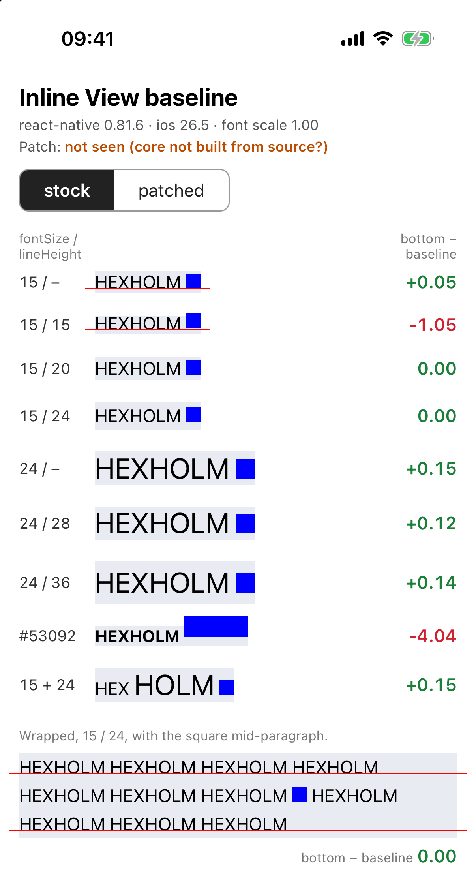 | 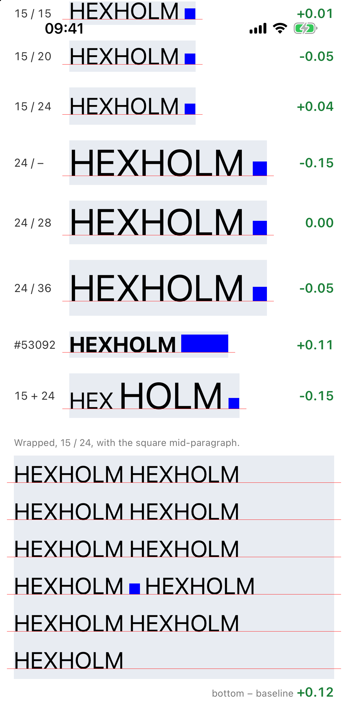 |

## Android

The same `App.tsx` on 0.88.0, on a Pixel 9 Pro emulator (API 35, 1280×2856,
density 3.0), at font scales 1.0 and 2.0: every view's bottom is on the
baseline to the pixel, in all 10 rows, and so are the letters.

| Android, font scale 1.0 | Android, font scale 2.0 |
| --- | --- |
| 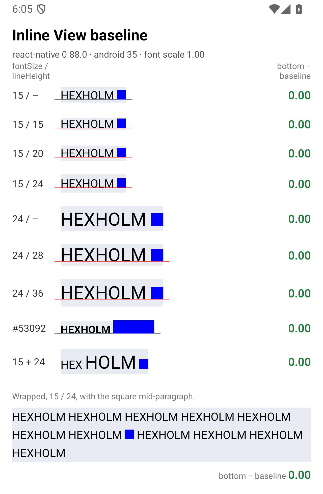 | 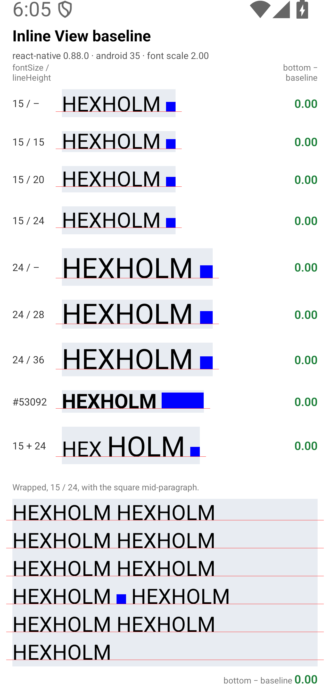 |

## The fix

Use the baseline TextKit laid the line out with: the line fragment's origin
plus the location of the view's glyph within it. That includes the baseline
offset, and doesn't depend on any font.

```objc
NSUInteger glyphIndex = attachmentGlyphRange.location;
CGRect lineFragmentRect = [layoutManager lineFragmentRectForGlyphAtIndex:glyphIndex effectiveRange:NULL];
CGFloat baseline = lineFragmentRect.origin.y + [layoutManager locationForGlyphAtIndex:glyphIndex].y;

CGRect frame = {.origin = {glyphRect.origin.x, baseline - attachmentSize.height}, .size = attachmentSize};
```

That's the 0.81 placement with the line's top in place of the glyph rect's, so
it matches 0.81 where 0.81 was right and fixes the overflowing case. It puts
every view in this repro on the baseline, at both text sizes, including #53092
and the mixed-size line.
[`react-native-nano-icons`](https://github.com/software-mansion-labs/react-native-nano-icons)
works around the bug on 0.82 and later with the same layout
([NanoIconInlineBaseline.mm](https://github.com/software-mansion-labs/react-native-nano-icons/blob/4c5114474ba627ecc439532a2ef1e64c8a046226/packages/react-native-nano-icons/ios/NanoIconInlineBaseline.mm#L9-L13)).

A view that overflows a clamped line still overflows it, and the `Text` clips
its top (#53092 at the default size, in the screenshots). The fix doesn't
change that.

## Related upstream

Not filed yet: [`ISSUE.md`](ISSUE.md) is the draft. Upstream already has:

- [#53092](https://github.com/react/react-native/issues/53092) (closed as
  stale): the overflowing case on 0.79, see [Version history](#version-history).
- [#53341](https://github.com/react/react-native/pull/53341): the 0.82.0 change.
- [#58967](https://github.com/react/react-native/pull/58967) (open, not
  reviewed yet): gives the view's run the text's font and subtracts the
  baseline offset. Applied to 0.88.0 here (not committed), it puts the view on
  the baseline in every single-font row at both sizes, but leaves the 15 + 24
  row +2.17pt low at the default size and +3.88pt at AX, because the line's
  descent there comes from the 24pt font.
- [#59420](https://github.com/react/react-native/pull/59420) (open, behind a
  new `fixTextInlineViewLineHeight` flag): grows lines to fit taller inline
  views, and subtracts the baseline offset when placing them. It still reads
  `font.descender` from the view's run, so going by the diff (not run here),
  the `|descender| - 2.76` part would remain: +0.86pt for 15pt text, +3.03pt
  for 24pt.
- [#54422](https://github.com/react/react-native/issues/54422) (open) is about
  Android wrapping inline views, but its iOS screenshot notes an "unrelated
  baseline positioning bug".
- [#49144](https://github.com/react/react-native/issues/49144) (open) asks for
  icons centered on the text, not a baseline bug.

## Environment

| | |
| --- | --- |
| react-native | 0.88.0 (the placement is the same in 0.88.1 and on `main` at [f754dbd](https://github.com/react/react-native/tree/f754dbd20a8548cddfa548815a6e1f4bb25b6443)) |
| react | 19.3.0 |
| Architecture | New (Fabric), Hermes |
| iOS | Simulator, iPhone 17 Pro, iOS 26.5, Debug build (Xcode 27.1) |
| Android | Emulator, Pixel 9 Pro, API 35, Debug build |
| Font | The system font |
| Dependencies | The template's, plus `patch-package` |

## Running it

```bash
cd ReproducerApp
yarn install                     # postinstall applies patches/ with patch-package
(cd ios && bundle install && RCT_USE_PREBUILT_RNCORE=0 bundle exec pod install)
yarn start
yarn ios                         # or yarn android
```

React Native 0.88 links its core from prebuilt XCFrameworks by default. The
patch to `RCTTextLayoutManager.mm` only takes effect if the core is compiled
from source, so `pod install` needs `RCT_USE_PREBUILT_RNCORE=0`. The bug itself
doesn't need the patch: **stock** mode runs upstream's code unchanged. The
second line of the screen says in green when the patch is compiled in, and
which placement the last layout used.

A source build also honours `RCT_METRO_PORT`, if you run Metro on another port
(`yarn start --port <port>`, then build with `RCT_METRO_PORT=<port>`). On
Android, build with `-PreactNativeDevServerPort=<port>`.

### Toggling the fix

[`patches/react-native+0.88.0.patch`](ReproducerApp/patches/react-native+0.88.0.patch)
changes only `RCTTextLayoutManager.mm`. Where `_measureTextStorage:` places each
inline view, it computes both placements, then reads `ReproInlineBaselineFix`
from `NSUserDefaults` to pick one. The **stock** and **patched** buttons set it
with `Settings.set()`. Every launch starts in stock mode. The switch is iOS
only.

- **stock:** upstream's frame, unchanged.
- **patched:** the fix above.

React Native caches text measurements by their layout-relevant attributes, so
flipping the switch alone wouldn't measure text again that has already been
laid out. In patched mode the samples also get `maxFontSizeMultiplier={1000}`,
which never applies but gives them their own cache entries.

The patch also logs the `[inline-baseline]` lines above. Watch them with
`xcrun simctl spawn booted log stream --predicate 'eventMessage CONTAINS "[inline-baseline]"'`.

### React Native 0.81.6

The 0.81.6 numbers come from a fresh 0.81.6 app with this repo's `App.tsx` and
no patches, built in Release with the prebuilt core:

```bash
npx @react-native-community/cli@20.0.2 init InlineBaseline081 --version 0.81.6
cp ReproducerApp/App.tsx InlineBaseline081/App.tsx
cd InlineBaseline081/ios && bundle install && RCT_USE_RN_DEP=1 RCT_USE_PREBUILT_RNCORE=1 bundle exec pod install
```

Its **stock/patched** switch does nothing, and its "Patch:" line says it's not
compiled in.

### Measurements

[`measurements/`](measurements) has the scripts behind the tables:
`capture-ios.sh` launches the app, takes the screenshots (scrolling with the
[RocketSim](https://www.rocketsim.app) CLI) and records the log; `measure.py`
finds each blue view and red hairline in a screenshot; `analyze.py` builds the
formula table from a log and four screenshots, and fails if a prediction
doesn't match; `crops.py` makes the images in `screenshots/`. They need Python
with Pillow and numpy.

## Screenshots

All on the iPhone 17 Pro simulator, React Native 0.88.0.

| | Stock | Patched |
| --- | --- | --- |
| Default size | 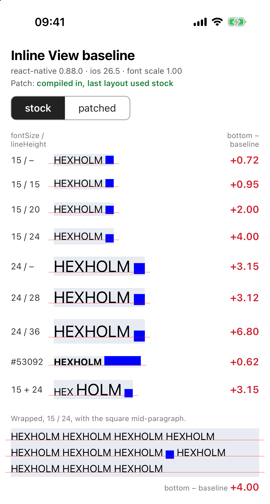 | 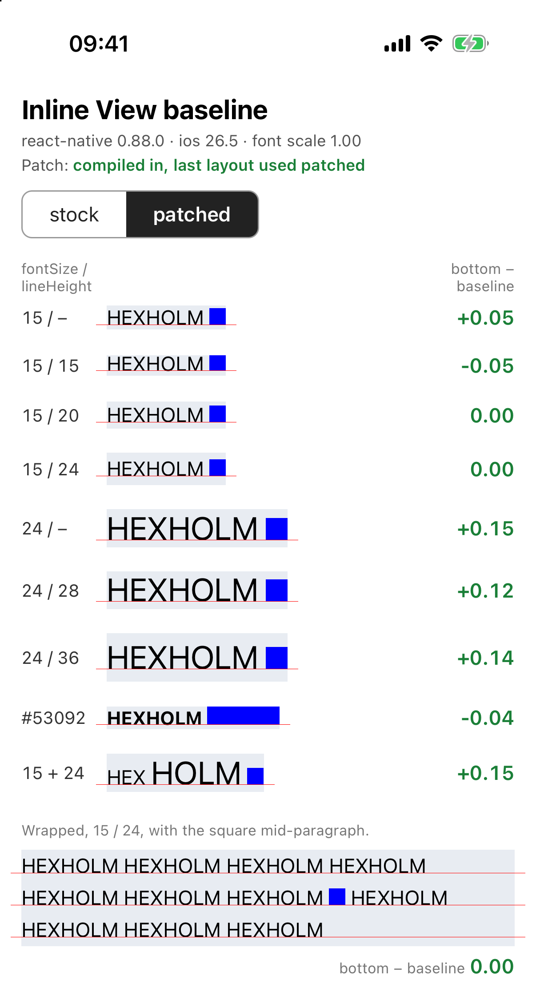 |
| AX | 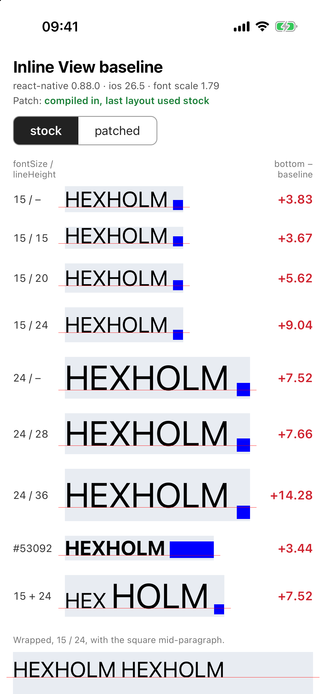 | 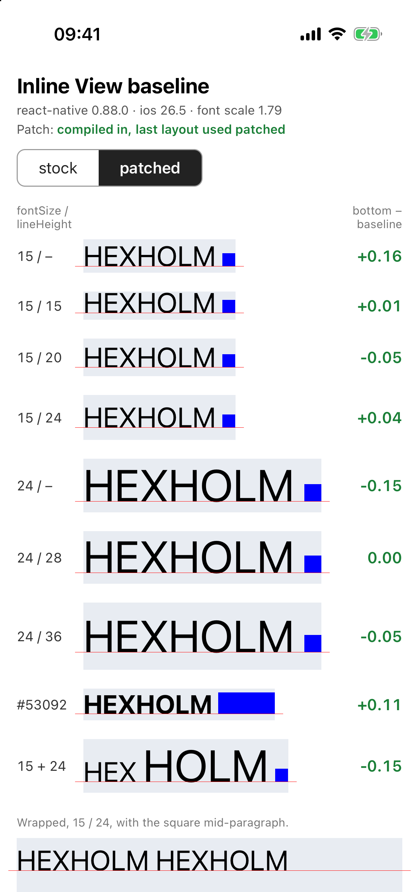 |
| AX, scrolled to the end | 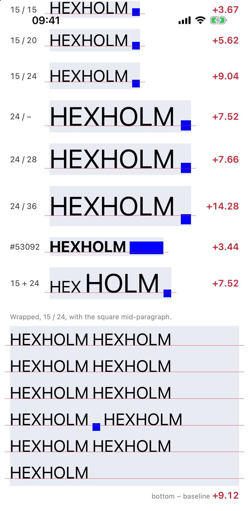 |  |

Also: [iOS 0.81.6 at AX, top of the screen](screenshots/ios-0.81.6-ax.png).
