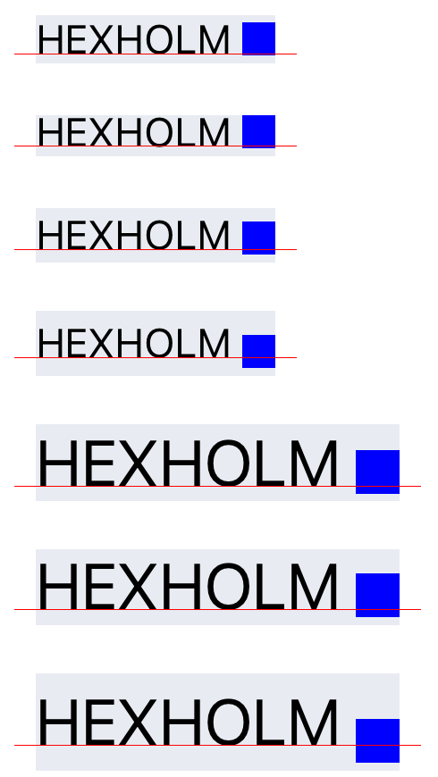
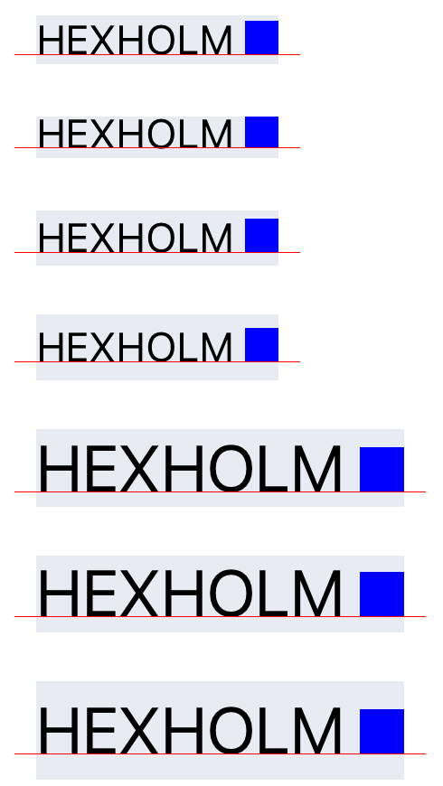

# iOS: a `View` nested in `Text` sits below the text baseline

A `View` inside a `Text` (an inline view) should sit with its bottom on the
text baseline, the same way the letters do. On iOS with the New Architecture
(React Native 0.82 and later, still the case on `main`), it sits below the
baseline. How far below depends on the font size and the `lineHeight`:

- **Without `lineHeight`,** the view is `|descender of the text's font| - 2.76`
  points low: 0.86pt for 15pt system text, 3.03pt for 24pt. 2.76 is the
  descender of 12pt Helvetica, TextKit's default font, which is the font React
  Native ends up reading from the view's run.
- **With a `lineHeight` taller than the font's line height,** it's another
  `(lineHeight - font.lineHeight) / 2` lower: 3.91pt in total for 15pt text with
  `lineHeight: 24`, 6.71pt for 24pt text with `lineHeight: 36`.
- **With Dynamic Type,** both terms grow with the text. At the first
  accessibility size, 15pt text with `lineHeight: 20` puts the view 5.58pt
  below the baseline.

| Stock (0.88.0) | Patched |
| --- | --- |
|  |  |

The red hairline is the baseline of the line, from `onTextLayout`. The letters
sit on it in both modes; only the blue square moves.

In the Bluesky app this is the verification badge after a display name: it sits
visibly low at the default text size, and a lot lower at the accessibility
sizes. Android and web put the bottom of the same view on the baseline. This
repro only runs the iOS side.

## Filed as

Not filed yet. [`ISSUE.md`](ISSUE.md) is the draft. Related:

- [react/react-native#53092](https://github.com/react/react-native/issues/53092)
  reported inline views misaligned by `lineHeight` on 0.79. It was closed as
  stale.
- [react/react-native#53341](https://github.com/react/react-native/pull/53341)
  ([6da351a](https://github.com/react/react-native/commit/6da351a5ed80a10138a5558afcb380410c8a93c9),
  first in 0.82) changed the placement to Paper's formula. That formula is the
  code this repro shows to be wrong on Fabric (see [Cause](#cause)).

## Environment

| | |
| --- | --- |
| react-native | 0.88.0 (the code is unchanged on `main` at [0941e95](https://github.com/react/react-native/tree/0941e95391d23cb2e0490d9c5a5b13886da424f2)) |
| react | 19.3.0 |
| Architecture | New (Fabric), Hermes |
| Reproduced on | iOS Simulator, iPhone 17 Pro, iOS 26.5, Debug build (Xcode 27.1) |
| Font | The system font (SF Pro) |
| Dependencies | The template's, plus `patch-package` |

## Running it

```bash
cd ReproducerApp
yarn install                     # postinstall applies patches/ with patch-package
(cd ios && bundle install && RCT_USE_PREBUILT_RNCORE=0 bundle exec pod install)
yarn start
yarn ios
```

React Native 0.88 links its core from prebuilt XCFrameworks by default. The
patch to `RCTTextLayoutManager.mm` only takes effect if the core is compiled
from source, so `pod install` needs `RCT_USE_PREBUILT_RNCORE=0`. The bug itself
doesn't need the patch: **stock** mode runs upstream's code unchanged. The
second line of the screen says in green when the patch is compiled in, and
which placement the last layout used.

A source build also honours `RCT_METRO_PORT`, if you run Metro on another port
(`yarn start --port <port>`, then build with `RCT_METRO_PORT=<port>`).

## What the screen shows

Each row is a `Text` with the word `HEXHOLM` and a blue square `View` nested
after it: 12pt squares in 15pt text, 16pt squares in 24pt text. The rows cover
no `lineHeight`, a `lineHeight` shorter than the font's own line height
(15 / 15 and 24 / 28), and taller ones. The last sample is a wrapped paragraph
(15 / 24) with the square at the end of its second line.

- **Red hairline:** the baseline of each line, at `line.y + line.ascender` from
  `onTextLayout`. The flat bottoms of the letters sit exactly on it.
- **Grey box:** the `Text`'s frame.
- **Number on the right:** the square's bottom minus the baseline of its line,
  in points. Positive is below the baseline. The square's frame comes from
  `measureLayout` (`onLayout` doesn't fire for views nested in `Text`) and has
  been rounded to the pixel grid, while the baseline hasn't, so the number is
  within about ±0.17pt of the exact value.

Only the samples follow the system text size, so that the rest of the screen
stays legible at the accessibility sizes.

## Toggling the fix

[`patches/react-native+0.88.0.patch`](ReproducerApp/patches/react-native+0.88.0.patch)
changes only `RCTTextLayoutManager.mm`. Where `_measureTextStorage:` places each
inline view, it computes both placements, then reads `ReproInlineBaselineFix`
from `NSUserDefaults` to pick one. The **stock** and **patched** buttons set it
with `Settings.set()`. Every launch starts in stock mode.

- **stock:** upstream's frame, unchanged.
- **patched:** the proposed fix (below).

React Native caches text measurements by their layout-relevant attributes, so
flipping the switch alone wouldn't measure text again that has already been
laid out. In patched mode the samples also get `maxFontSizeMultiplier={1000}`,
which never applies but gives them their own cache entries.

The patch also logs both placements for every inline view, as
`[inline-baseline]` lines in the device log, with the font it found on the
view's run:

```text
[inline-baseline] stock: 12x12 view, line 0.00..24.00, baseline 17.33, attachment font Helvetica 12.0 (descender -2.76): stock bottom 21.24 (+3.91 from baseline), fixed bottom 17.33
```

## Results

iPhone 17 Pro simulator, iOS 26.5. "Native" is the exact offset from the
patch's log. "On screen" is measured from the screenshots' pixels (3px per
point), as the distance from the bottom edge of the blue square to the top of
the red hairline. The bottoms of the letters were on the hairline in every row
of every screenshot. Positive is below the baseline.

### Default text size

[stock](screenshots/stock.png), [patched](screenshots/patched.png)

| fontSize / lineHeight | Line box | Stock, native | Stock, on screen | Patched, on screen |
| --- | ---: | ---: | ---: | ---: |
| 15 / none | 17.90 | **+0.86** | +0.67 | 0 |
| 15 / 15 | 15 | **+0.86** | +1.00 | 0 |
| 15 / 20 | 20 | **+1.91** | +2.00 | 0 |
| 15 / 24 | 24 | **+3.91** | +4.00 | 0 |
| 24 / none | 28.64 | **+3.03** | +3.00 | 0 |
| 24 / 28 | 28 | **+3.03** | +3.00 | 0 |
| 24 / 36 | 36 | **+6.71** | +6.67 | 0 |
| Wrapped 15 / 24, line 2 | 24 | **+3.91** | +4.00 | 0 |

### First accessibility text size

`accessibility-medium`, font scale 1.79. [stock](screenshots/stock-ax.png),
[patched](screenshots/patched-ax.png). `fontSize` and `lineHeight` scale with
the text size; the squares don't.

| fontSize / lineHeight (unscaled) | Line box | Stock, native | Stock, on screen | Patched, on screen |
| --- | ---: | ---: | ---: | ---: |
| 15 / none | 31.97 | **+3.70** | +3.67 | 0 |
| 15 / 15 | 26.79 | **+3.70** | +3.67 | 0 |
| 15 / 20 | 35.72 | **+5.58** | +5.67 | 0 |
| 15 / 24 | 42.86 | **+9.15** | +9.00 | 0 |
| 24 / none | 51.15 | **+7.58** | +7.67 | 0 |
| 24 / 28 | 50.01 | **+7.58** | +7.67 | 0 |
| 24 / 36 | 64.30 | **+14.15** | +14.33 | 0 |
| Wrapped 15 / 24 | 42.86 | **+9.15** | +9.00 | 0 |

Every stock number is `(line bottom - baseline) - 2.76`. A `lineHeight` shorter
than the font's (15 / 15, 24 / 28) has the same error as no `lineHeight` at
all: TextKit trims the line from the top and keeps the descent, and React
Native adds no baseline offset.

## Cause

In `_measureTextStorage:` in
[`RCTTextLayoutManager.mm`](https://github.com/react/react-native/blob/0941e95391d23cb2e0490d9c5a5b13886da424f2/packages/react-native/ReactCommon/react/renderer/textlayoutmanager/platform/ios/react/renderer/textlayoutmanager/RCTTextLayoutManager.mm#L645-L653),
each inline view's frame is the bottom of its glyph rect, plus the descender of
the font on the view's own run:

```objc
UIFont *font = [[textStorage attributedSubstringFromRange:range] attribute:NSFontAttributeName
                                                                   atIndex:0
                                                            effectiveRange:nil];
frame = {
    .origin =
        {glyphRect.origin.x,
         glyphRect.origin.y + glyphRect.size.height - attachmentSize.height + font.descender},
    .size = attachmentSize};
```

That's only the baseline if the run's font is the text's font and the line has
no extra height. Neither holds:

1. **The view's run has no font.** `RCTNSAttributedStringFragmentFromFragment`
   ([`RCTAttributedTextUtils.mm`](https://github.com/react/react-native/blob/0941e95391d23cb2e0490d9c5a5b13886da424f2/packages/react-native/ReactCommon/react/renderer/textlayoutmanager/platform/ios/react/renderer/textlayoutmanager/RCTAttributedTextUtils.mm#L412-L423))
   gives an attachment only `NSAttachmentAttributeName`, so `NSTextStorage`
   fills in its default font, 12pt Helvetica, with a descender of -2.76. Every
   view is placed as if it sat in 12pt Helvetica, whatever the text around it
   is.
2. **A custom `lineHeight` moves the baseline.** When `lineHeight` is taller
   than the font's line height, `RCTApplyBaselineOffset`
   ([`RCTAttributedTextUtils.mm`](https://github.com/react/react-native/blob/0941e95391d23cb2e0490d9c5a5b13886da424f2/packages/react-native/ReactCommon/react/renderer/textlayoutmanager/platform/ios/react/renderer/textlayoutmanager/RCTAttributedTextUtils.mm#L378-L384))
   raises the glyphs by `(lineHeight - font.lineHeight) / 2` with
   `NSBaselineOffsetAttributeName`, to center them in the line. The bottom of
   the line plus a descender doesn't include that.

This formula came from Paper in
[#53341](https://github.com/react/react-native/pull/53341). In 0.81 and
earlier, Fabric used `[layoutManager locationForGlyphAtIndex:].y` like the fix
below, but added it to the top of the glyph's bounding rect rather than of its
line fragment. `react-native-nano-icons` treats 0.81 and earlier as correct,
while [#53092](https://github.com/react/react-native/issues/53092) reported a
misalignment with `lineHeight` on 0.79. We haven't run 0.81 here.

## The fix

Use the baseline TextKit laid the line out with: the line fragment's origin
plus the location of the view's glyph within it. That already includes the
baseline offset, and doesn't depend on any font.

```objc
NSUInteger glyphIndex = attachmentGlyphRange.location;
CGRect lineFragmentRect = [layoutManager lineFragmentRectForGlyphAtIndex:glyphIndex effectiveRange:NULL];
CGFloat baseline = lineFragmentRect.origin.y + [layoutManager locationForGlyphAtIndex:glyphIndex].y;

CGRect frame = {.origin = {glyphRect.origin.x, baseline - attachmentSize.height}, .size = attachmentSize};
```

That's the baseline `onTextLayout` reports for each line, and the one the
letters are drawn on. With it, the square sits exactly on the baseline in every
row above, at both text sizes.
[`react-native-nano-icons`](https://github.com/software-mansion-labs/react-native-nano-icons)
works around the bug on 0.82 and later with the same layout, in
`ios/NanoIconInlineBaseline.mm`.
